# Analisis Sensitivitas dan Kesalahan Klasifikasi Tanda Retinopati Diabetik Menggunakan k-Nearest Neighbors dan Decision Tree

**Mini Project Machine Learning Bioinformatika, Kelompok 7**

Proyek ini menguji klasifikasi tanda retinopati diabetik dari fitur numerik hasil pengolahan citra fundus. Analisis memberi perhatian pada sensitivity/recall kelas positif dan false negative (FN). Hasil k-NN yang ditampilkan merupakan hasil sementara dari artefak yang tersedia. Notebook asli dari Elvin kini tersedia dengan output eksekusi tersimpan; notebook tersebut belum dijalankan ulang di repository ini.

Repository ini dikelola dan disusun sebagai tempat terpusat untuk mengumpulkan, mendokumentasikan, dan menampilkan hasil proyek. Eksperimen dan materi yang dihimpun merupakan kerja kolaboratif anggota Kelompok 7 sesuai pembagian tugas masing-masing.

> Proyek ini merupakan eksperimen akademik, bukan alat diagnosis klinis. Dataset berisi fitur hasil ekstraksi citra retina, bukan foto fundus mentah.

## Gambaran proyek

Retinopati diabetik dapat merusak pembuluh darah retina dan mengganggu penglihatan. Proposal proyek merencanakan penggunaan machine learning untuk mempelajari pola pada fitur retina dan membandingkan k-Nearest Neighbors (k-NN) dengan Decision Tree. Perhatian khusus diberikan pada kasus positif yang salah diklasifikasikan sebagai negatif, karena kesalahan tersebut tercatat sebagai FN.

## Tujuan penelitian

- Mengembangkan model k-NN dan Decision Tree untuk klasifikasi tanda retinopati diabetik.
- Membandingkan sensitivity/recall, FN, dan metrik evaluasi lain pada data uji.
- Menganalisis kontribusi fitur dan dampak fitur pemeriksaan awal terhadap klasifikasi.

## Dataset

Dataset **Diabetic Retinopathy Debrecen** diperoleh dari [UCI Machine Learning Repository, ID 329](https://archive.ics.uci.edu/dataset/329/diabetic+retinopathy+debrecen), DOI [10.24432/C5XP4P](https://doi.org/10.24432/C5XP4P). Dataset awal berisi 1.151 observasi, 19 fitur prediktor, dan satu target biner.

| Komponen | Keterangan |
|---|---|
| Kelas 0 | Tidak ada tanda retinopati diabetik |
| Kelas 1 | Ada tanda retinopati diabetik |
| Kelompok fitur | Kualitas citra, pre-screening, enam fitur microaneurysms, delapan fitur exudates, jarak makula ke diskus optik, diameter diskus optik, keluaran AM/FM |

Dataset mentah tidak disertakan. Cara memperoleh data dijelaskan di [data/README.md](data/README.md). Notebook EDA mengambil data melalui ucimlrepo menggunakan ID UCI 329.

## Alur pengerjaan dan progres

| Tahap | Penanggung jawab | Progres dan berkas |
|---|---|---|
| Exploratory Data Analysis (EDA) | Fajar Dhuha Zafran | Tersedia, termasuk notebook asli dengan output. [Buka notebook](notebooks/eda/Analisis_EDA_Diabetic_Retinopathy_Kelompok_7.ipynb) |
| Dataset dan preprocessing | Isnaini Tiana Hayu | Tersedia dalam pipeline EDA dan preprocessing, termasuk audit, split, dan scaling. [Buka notebook](notebooks/preprocessing/Pipeline_EDA_dan_Preprocessing_Diabetic_Retinopathy_Kelompok_7.ipynb) |
| k-NN | Elvin Ramadhani | Notebook asli dengan output tersimpan dan artefak evaluasi tersedia. [Buka notebook asli](notebooks/knn/uji_k_NN_kel7.ipynb). [Lihat salinan konversi sebelumnya](notebooks/knn/uji_k_NN_konversi_gemini.ipynb). |
| Decision Tree | Abid Ra'fad Aziz | Notebook hasil run beserta output dan artefak evaluasi tersedia. [Buka notebook](notebooks/decision_tree/Decision_Tree_DR.ipynb). |
| Perbandingan dan dokumentasi | Rakan Fawwaz Irawadi | Perbandingan final menunggu hasil Decision Tree. |

Urutan analisis mencakup EDA, audit dan preprocessing, pembagian data, scaling untuk k-NN, lalu eksperimen k-NN dan Decision Tree. Hasil kedua model sudah tersedia, tetapi analisis perbandingan final dari Rakan belum selesai.

## Hasil EDA

EDA mencatat 1.151 observasi dan 19 fitur. Tidak ditemukan missing values. Terdapat lima baris duplikat identik. Distribusi label awal adalah 540 kelas 0 dan 611 kelas 1. Kolom exudate3 dan exudate4 identik pada data yang dianalisis; korelasi ma1 dengan ma2 sekitar 0,996. Median ma3 kelas positif adalah 39, dibanding 24 pada kelas negatif. Median exudate4 kelas positif sedikit lebih rendah, 4,368 dibanding 4,576 pada kelas negatif, sehingga pola median tidak sama untuk semua fitur.

### Distribusi kelas

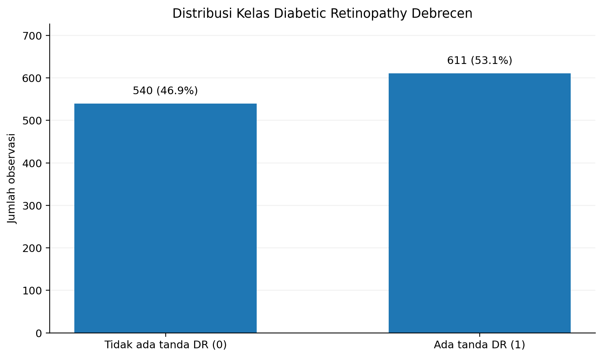

Jumlah kelas 0 dan kelas 1 sebelum penghapusan duplikat adalah 540 dan 611.

### Histogram fitur terpilih

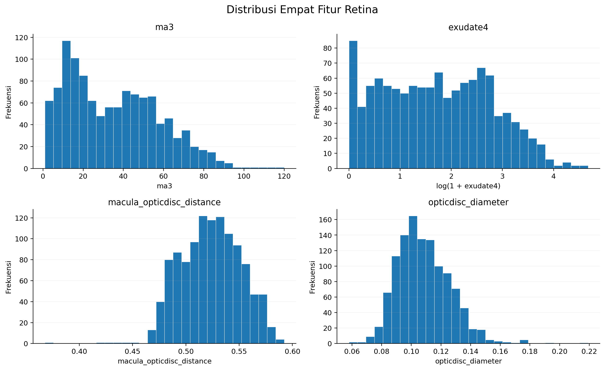

Histogram memperlihatkan sebaran empat fitur yang dipilih dari kelompok microaneurysms, exudates, serta ukuran anatomi retina. Sebagian fitur divisualisasikan dengan transformasi log untuk menampilkan sebaran yang menceng.

### Boxplot fitur per kelas

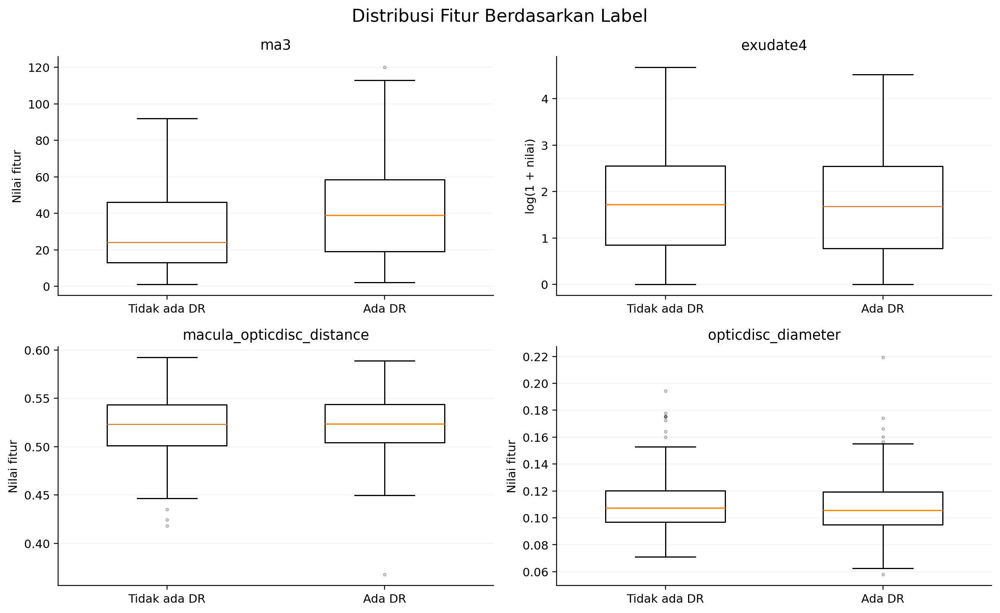

Boxplot membandingkan sebaran empat fitur terpilih menurut label. Median ma3 kelas positif lebih tinggi, sedangkan median exudate4 sedikit lebih rendah. Visualisasi ini bersifat deskriptif dan tidak menunjukkan hubungan sebab-akibat.

### Matriks korelasi

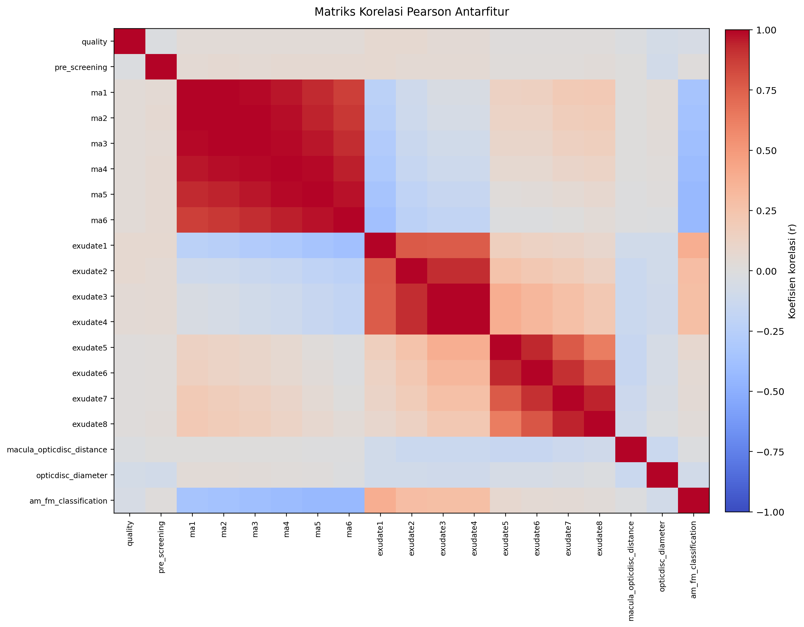

Matriks menampilkan korelasi Pearson antarfitur. Pasangan exudate3 dan exudate4 berkorelasi 1,000; nilai CSV menunjukkan kedua kolom identik pada dataset ini. Fitur ma1 dan ma2 berkorelasi sekitar 0,996.

## Preprocessing

Audit preprocessing mencatat 1.151 baris awal, tanpa NaN atau Inf, dan lima baris duplikat identik yang dihapus sebelum pembagian data. Dataset bersih berisi 1.146 observasi. Pembagian dilakukan secara stratified dengan rasio 80:20 dan random_state=42: 916 data latih dan 230 data uji. CSV split menunjukkan proporsi kelas sebanding pada kedua partisi.

StandardScaler di-fit pada data latih untuk mencegah statistik data uji masuk ke proses fit. Dua skenario disiapkan:

- **19 fitur:** semua fitur prediktor.
- **17 fitur:** tanpa quality dan pre_screening.

### Distribusi kelas pada split

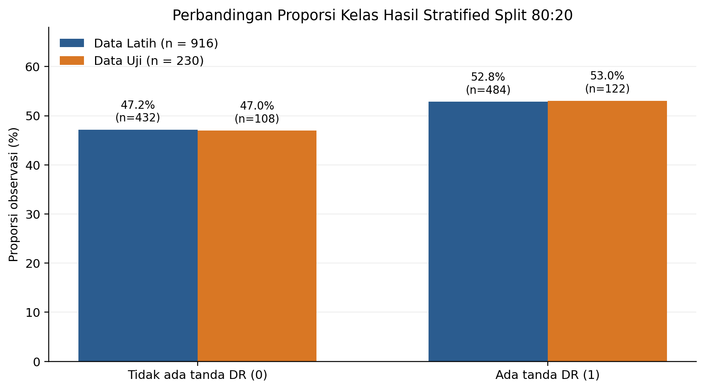

Grafik membandingkan komposisi kelas pada dataset bersih, data latih, dan data uji. Jumlah aktual setiap kelas tersedia pada [ringkasan stratified split](hasil/preprocessing/03_ringkasan_stratified_split.csv).

### Perbandingan scaling

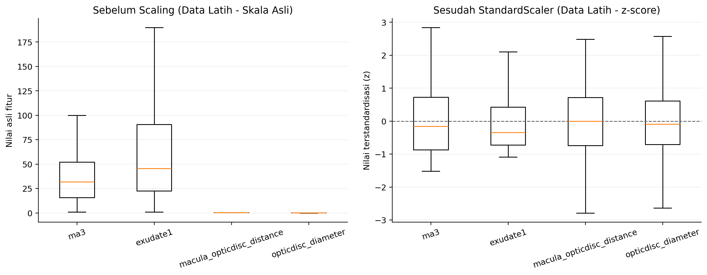

Visualisasi membandingkan skala fitur sebelum dan sesudah standardisasi. Verifikasi numerik untuk data latih dan uji tersedia di [CSV verifikasi StandardScaler](hasil/preprocessing/04_verifikasi_standard_scaler.csv).

## Eksperimen k-NN

Notebook yang tersedia menggunakan KNeighborsClassifier dengan Euclidean distance dan uniform weights. Tuning dilakukan pada data latih menggunakan StratifiedKFold 10-fold dengan pengacakan dan random_state=42. Kandidat k adalah bilangan ganjil dari 1 sampai 35.

Pada notebook asli Elvin, k dipilih berdasarkan F1 CV tertinggi, dengan recall lalu ROC-AUC sebagai pemecah seri. Aturan tersebut menghasilkan k=21 untuk 19 fitur dan k=17 untuk 17 fitur dalam CSV tuning. Recall CV tertinggi sendiri terjadi pada k=1 dan k=3. Notebook asli memuat output dari eksekusi sebelumnya; output metrik dan konfigurasi cocok dengan artefak CSV. Notebook tidak dijalankan ulang saat diperiksa, sehingga hasil ini belum direproduksi secara independen di repository.

## Hasil evaluasi k-NN

Tabel berikut dicocokkan dengan hasil/knn/evaluasi_uji_knn.csv. Evaluasi memakai 230 observasi pada test set, termasuk 122 sampel positif.

| Metrik | 19 fitur | 17 fitur |
|---|---:|---:|
| k terpilih | 21 | 17 |
| Accuracy | 63,04% | 58,26% |
| Precision | 68,32% | 63,54% |
| Recall / sensitivity | 56,56% | 50,00% |
| F1-score | 61,88% | 55,96% |
| ROC-AUC | 0,7050 | 0,6781 |
| TP | 69 | 61 |
| TN | 76 | 73 |
| FP | 32 | 35 |
| FN | 53 | 61 |
| FNR | 43,44% | 50,00% |

Pada skenario 19 fitur, 69 dari 122 sampel positif terdeteksi dan 53 menjadi FN. Pada skenario 17 fitur, 61 terdeteksi dan 61 menjadi FN. Dengan demikian, sensitivity/recall masing-masing 56,56% dan 50,00%. Accuracy saja tidak cukup untuk menggambarkan jumlah kasus positif yang terlewat; recall, FN, dan FNR perlu dibaca bersama. Hasil ini masih sementara dan tidak dapat ditafsirkan sebagai kinerja klinis.

### Kurva cross-validation

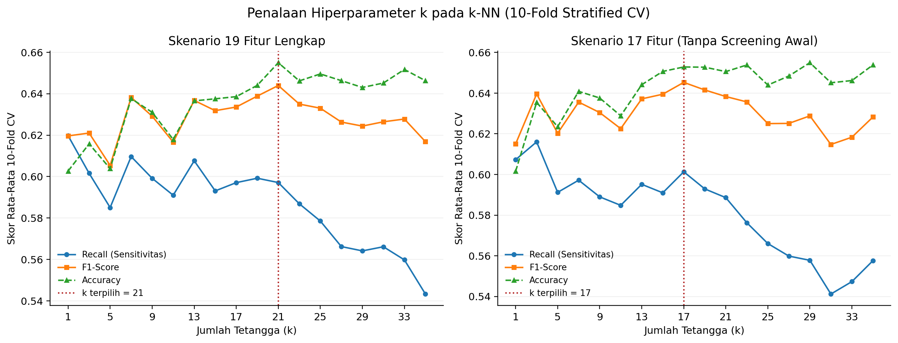

Grafik menunjukkan skor accuracy, recall, dan F1 pada kandidat k di kedua skenario. Garis vertikal menandai k terpilih menurut F1 CV pada notebook asli.

### Confusion matrix

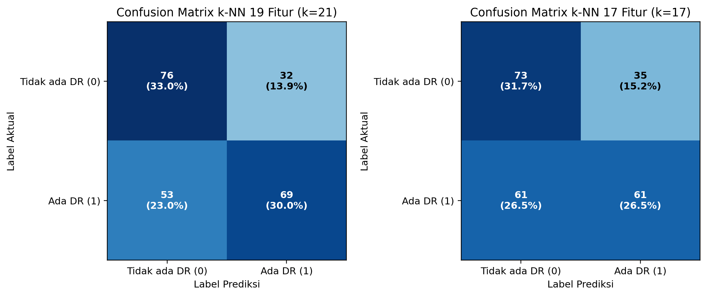

Confusion matrix memperlihatkan TP, TN, FP, dan FN pada test set untuk skenario 19 dan 17 fitur. Nilai FN pada kedua skenario juga tercantum dalam tabel evaluasi di atas.

### Kurva ROC

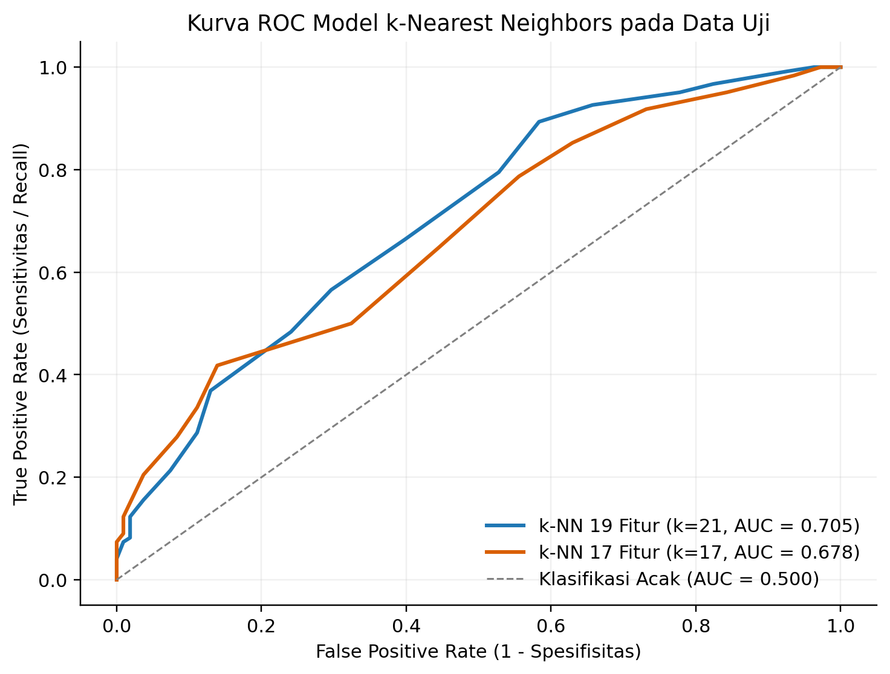

Kurva membandingkan true positive rate dan false positive rate pada berbagai ambang skor, dengan ROC-AUC 0,7050 untuk 19 fitur dan 0,6781 untuk 17 fitur.

## Eksperimen Decision Tree

Notebook utama [Decision_Tree_DR.ipynb](notebooks/decision_tree/Decision_Tree_DR.ipynb) berasal dari Abid dan memuat output tersimpan untuk seluruh 10 sel kode, dengan execution count 1 sampai 10. Notebook tidak dijalankan ulang saat integrasi. Dataset train dan test masing-masing berisi 916 dan 230 observasi untuk kedua konfigurasi, dengan pembagian kelas yang cocok dengan artefak preprocessing.

Decision Tree menggunakan fitur unscaled. Skenario 19 fitur memakai seluruh prediktor; skenario 17 fitur menghilangkan quality dan pre_screening. Baseline menggunakan DecisionTreeClassifier dengan random_state=42. Tuning memakai StratifiedKFold 5-fold dan refit berdasarkan recall. Parameter yang dicari mencakup max_depth, min_samples_leaf, min_samples_split, dan ccp_alpha.

### Hasil baseline dan tuned

Angka pada tabel dicocokkan dengan CSV hasil_dt, output notebook, dan CSV parameter. Semua metrik dihitung pada test set 230 observasi.

| Skenario | Model | Accuracy | Precision | Recall | F1-score | ROC-AUC | FN |
|---|---|---:|---:|---:|---:|---:|---:|
| 19 fitur | Baseline | 0,6000 | 0,6316 | 0,5902 | 0,6102 | 0,6006 | 50 |
| 19 fitur | Tuned | 0,6261 | 0,6607 | 0,6066 | 0,6325 | 0,6785 | 48 |
| 17 fitur | Baseline | 0,6435 | 0,6786 | 0,6230 | 0,6496 | 0,6448 | 46 |
| 17 fitur | Tuned | 0,6826 | 0,7290 | 0,6393 | 0,6812 | 0,7329 | 44 |

Pada hasil tuned, konfigurasi 17 fitur mencatat recall 0,6393 dan 44 FN dari 122 sampel positif; konfigurasi 19 fitur mencatat recall 0,6066 dan 48 FN. Baseline 17 fitur juga memiliki recall lebih tinggi dan FN lebih rendah daripada baseline 19 fitur. Ini ringkasan deskriptif dari hasil yang tersedia, bukan perbandingan final antarmodel.

Parameter terbaik yang tersimpan:

- **19 fitur:** max_depth=15, min_samples_leaf=5, min_samples_split=2, ccp_alpha=0.
- **17 fitur:** max_depth=11, min_samples_leaf=5, min_samples_split=2, ccp_alpha=0.

### Tuning dan pruning

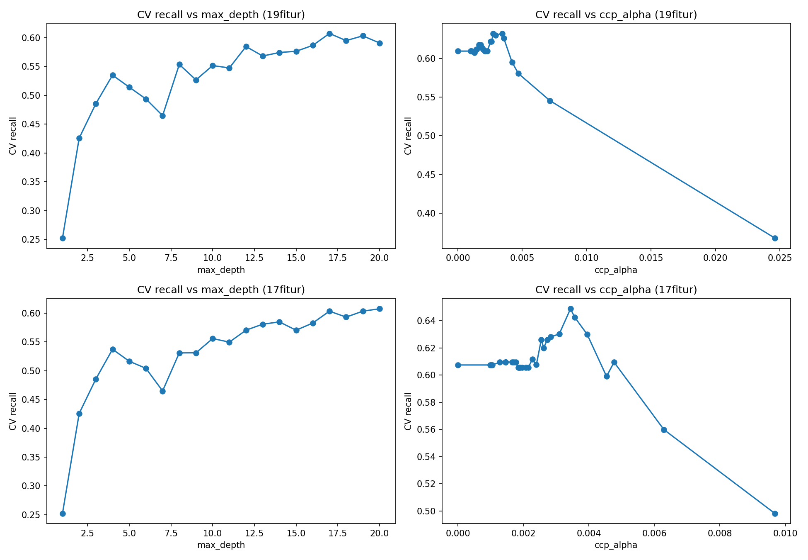

Grafik merangkum perubahan recall cross-validation terhadap max_depth dan ccp_alpha pada kedua konfigurasi. Parameter akhir dipilih melalui pencarian grid di data latih.

### Confusion matrix

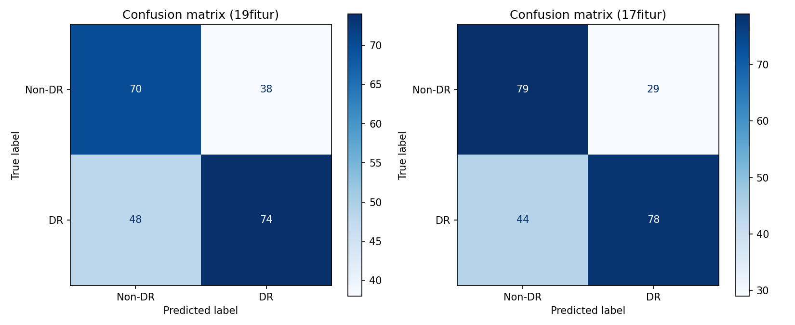

Matriks menampilkan perbandingan baseline dan tuned untuk konfigurasi 19 dan 17 fitur. Pada model tuned, jumlah FN adalah 48 untuk 19 fitur dan 44 untuk 17 fitur.

### Feature importance

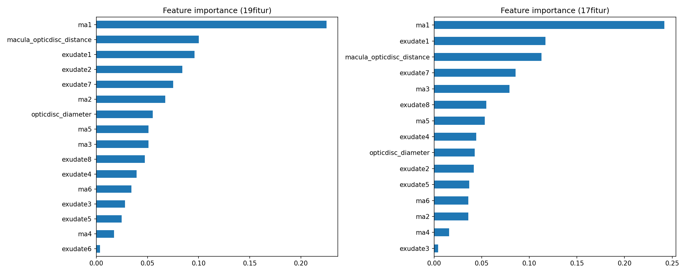

Grafik membandingkan Gini importance dan permutation importance berdasarkan recall. Untuk kedua konfigurasi, ma1 memiliki Gini importance terbesar pada tabel: 0,2249 untuk 19 fitur dan 0,2419 untuk 17 fitur. Permutation importance mengukur perubahan skor recall ketika nilai fitur diacak; nilai negatif tidak berarti kontribusi kausal.

### Visualisasi pohon

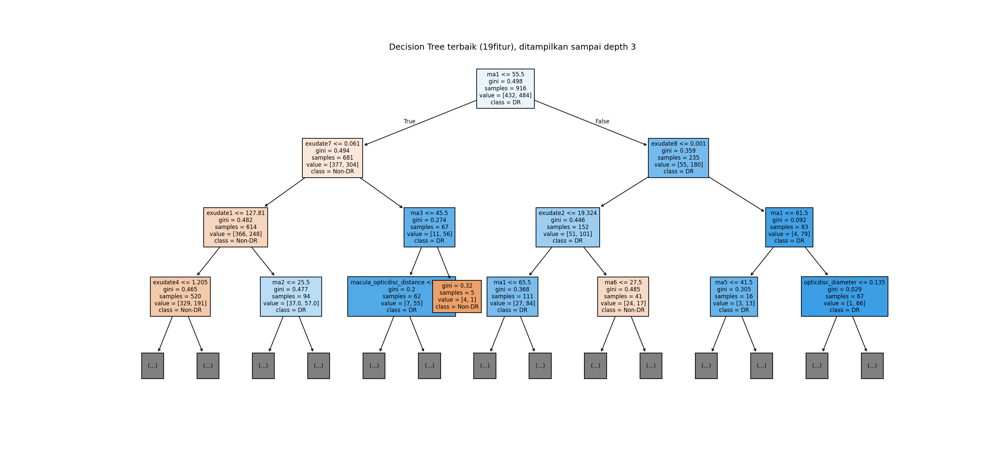

Pohon tuned untuk konfigurasi 19 fitur dengan max_depth=15.


Pohon tuned untuk konfigurasi 17 fitur dengan max_depth=11.

CSV evaluasi, best parameters, dan feature importance tersedia di [folder hasil Decision Tree](hasil/decision_tree/). Berkas model joblib juga disertakan sebagai artefak model hasil eksperimen.

## Pembahasan sementara dan batasan

Dalam hasil k-NN yang tersedia, skenario 19 fitur memiliki recall lebih tinggi dan FN lebih sedikit daripada skenario 17 fitur. Pada Decision Tree tuned, skenario 17 fitur mencatat recall lebih tinggi dan FN lebih sedikit daripada 19 fitur. Karena k-NN memilih k berdasarkan F1 dengan stratified 10-fold CV, sedangkan Decision Tree menggunakan stratified 5-fold CV dan refit recall, serta notebook k-NN belum dijalankan ulang, angka ini belum cukup untuk menyatakan model mana yang lebih baik secara final. Perbandingan perlu menyelaraskan prosedur evaluasi dan dibahas oleh tim.

Data yang digunakan berupa fitur tabular dari citra fundus, bukan foto mentah. Ukuran dataset dan satu pembagian data uji membatasi generalisasi. Hasil tidak ditujukan untuk diagnosis atau keputusan klinis. Pengerjaan Decision Tree belum tersedia, sehingga perbandingan final kedua algoritma belum dapat dibuat.

## Struktur repository

```text
README.md
requirements.txt
data/
  README.md
notebooks/
  eda/
  preprocessing/
  knn/
    uji_k_NN_kel7.ipynb
    uji_k_NN_konversi_gemini.ipynb
  decision_tree/
    Decision_Tree_DR.ipynb
hasil/
  eda/
  preprocessing/
  knn/
  decision_tree/
```

Folder notebooks/ menyimpan notebook analisis asli dan salinan konversi k-NN. Folder hasil/ berisi CSV, TXT, PDF, PNG, scaler, serta model joblib yang mendukung dokumentasi atau reproduksi. Folder data/ menjelaskan sumber dan cara memperoleh dataset. Proposal PDF tidak disertakan karena memuat NIM anggota. ZIP output Decision Tree diekstrak dan tidak dimasukkan.

## Instalasi dan penggunaan

Clone repository, buat lingkungan virtual, pasang dependensi, lalu buka Jupyter:

```bash
git clone https://github.com/FDZ3006/mini-projek-ml-bioinformatika-kelompok-7.git
cd mini-projek-ml-bioinformatika-kelompok-7
python -m venv .venv
source .venv/bin/activate
python -m pip install -r requirements.txt
jupyter notebook
```

Dataset mentah tidak disertakan. Ikuti petunjuk pada [data/README.md](data/README.md). Notebook EDA mengambil dataset UCI saat dijalankan dan memerlukan koneksi internet. Notebook k-NN mencari CSV preprocessing secara rekursif dari direktori kerja jika ZIP input Colab tidak tersedia. Buka Jupyter dari akar repository agar pencarian mencakup hasil/preprocessing/. Notebook Decision Tree dirancang untuk Google Colab dan meminta empat CSV train/test melalui mekanisme upload jika file tidak berada di direktori kerjanya. Notebook asli memuat output tersimpan, tetapi tidak dijalankan ulang dalam repository ini.

## Referensi

- Antal, B. dan Hajdu, A. (2014). *An ensemble-based system for automatic screening of diabetic retinopathy*. Knowledge-Based Systems, 60, 20-27. [https://doi.org/10.1016/j.knosys.2013.12.023](https://doi.org/10.1016/j.knosys.2013.12.023)
- UCI Machine Learning Repository. *Diabetic Retinopathy Debrecen*, dataset 329. [https://doi.org/10.24432/C5XP4P](https://doi.org/10.24432/C5XP4P)

## Anggota kelompok

| Anggota | Tanggung jawab |
|---|---|
| Fajar Dhuha Zafran | EDA dan analisis biologis |
| Isnaini Tiana Hayu | Dataset dan preprocessing |
| Elvin Ramadhani | k-NN |
| Abid Ra'fad Aziz | Decision Tree |
| Rakan Fawwaz Irawadi | Perbandingan model, kesimpulan, dan dokumentasi |

NIM tidak dicantumkan. Proposal asli yang memuat NIM disimpan lokal dan dikecualikan dari repository publik.

## Status pengerjaan

- **EDA:** tersedia beserta notebook dan hasil.
- **Preprocessing:** tersedia beserta notebook dan hasil.
- **k-NN:** notebook asli Elvin dengan output tersimpan dan artefak evaluasi tersedia; notebook belum dijalankan ulang di repository ini.
- **Decision Tree:** notebook hasil run, output, evaluasi baseline/tuned, tuning, feature importance, dan visualisasi pohon tersedia.
- **Perbandingan final:** belum selesai.
